# PS5-OS : ta NumWorks en console de salon

**PS5-OS transforme l'écran d'accueil de la NumWorks (n0110, n0115 ou n0120)
en menu de console de salon nouvelle génération** : un fond sombre éclairé par
la couleur de l'appli choisie, des rubans de lumière, des étincelles qui
montent, une rangée de tuiles où l'appli choisie est toujours la première et
la plus grande, un grand titre, un bouton **Ouvrir** et une rangée
**À découvrir**. Au démarrage, un rayon de lumière s'ouvre puis la console te
demande **« Qui joue ? »**. Toutes les applis de la calculatrice passent au
bleu.

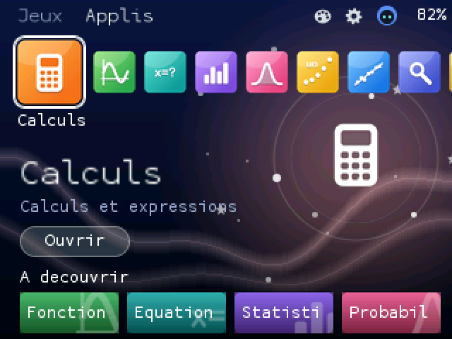

<p align="center">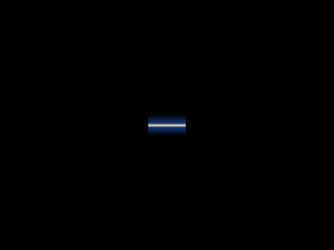</p>

> Captures prises dans le simulateur (batterie affichée à 82 %). Sur la
> calculatrice, tes jeux `.nwa` gardent leur propre icône.

## L'écran d'accueil

- **Démarrage** : un rayon de lumière s'ouvre au milieu de l'écran noir,
  « PS5-OS » apparaît, puis l'écran **« Qui joue ? »** avec Joueur 1, un
  petit robot original, dans un halo qui respire. OK pour entrer.
- **Deux onglets, Jeux et Applis** : les jeux `.nwa` installés d'un côté, les
  applis de la calculatrice de l'autre. Chaque onglet garde sa sélection.
- **La rangée de tuiles** : l'appli choisie est toujours au début, en grand,
  avec son nom dessous et un cadre blanc qui pulse ; les autres glissent
  derrière. Au retour d'une appli, les tuiles reviennent en glissant.
- **L'image d'en-tête** : le fond prend la couleur de l'appli (halo de
  lumière, deux rubans qui changent de forme d'une appli à l'autre), son
  grand symbole flotte au milieu d'une orbite où tournent trois lumières, et
  des étincelles montent doucement.
- **Le titre, la description et le bouton Ouvrir**, qui glissent en place à
  chaque changement d'appli.
- **À découvrir** : quatre bannières des applis suivantes, pour les ouvrir
  directement.
- **La barre du haut** : Jeux, Applis, Thèmes (palette), Paramètres
  (engrenage), Profil (robot) et la batterie (un éclair quand elle charge).
- **Profil** : un panneau avec Joueur 1, le nombre d'applis et de jeux, le
  nombre de lancements depuis l'allumage et la batterie.
- **Ouverture d'une appli** : la tuile grandit jusqu'à un écran de
  lancement aux couleurs de l'appli (grand symbole, nom, petit cercle de
  chargement), qui s'assombrit avant que l'appli s'ouvre.
- **6 thèmes** : Cosmos, Nébuleuse, Abysses, Braise, Forêt et Ardoise. Les
  nouvelles couleurs balaient l'écran derrière une barre de lumière.

| Démarrage | Qui joue ? | Accueil | À découvrir |
| --- | --- | --- | --- |
| 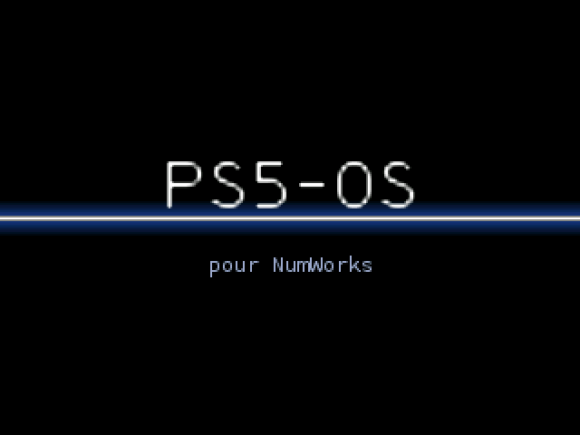 | 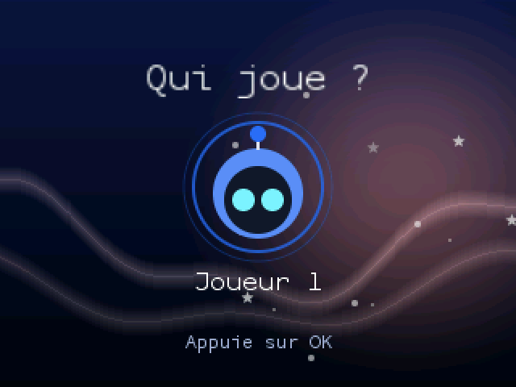 | 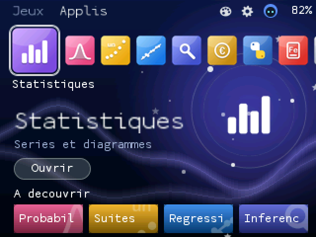 | 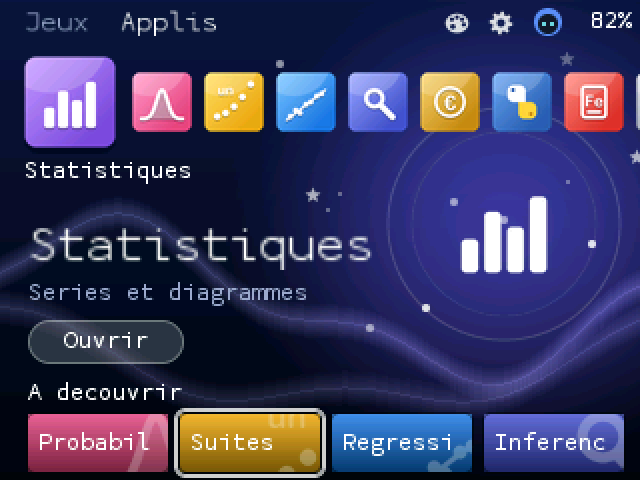 |

| Onglet Jeux | Nébuleuse | Braise | Profil |
| --- | --- | --- | --- |
| 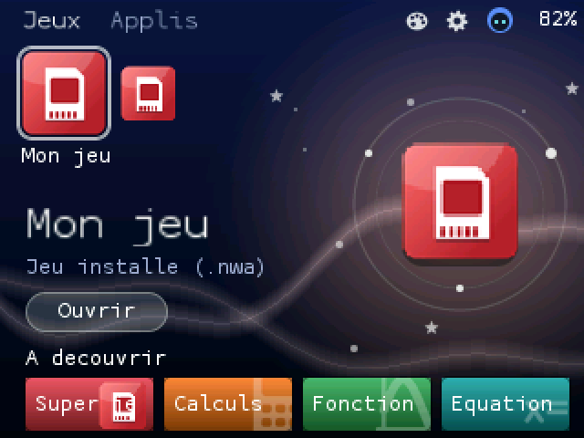 | 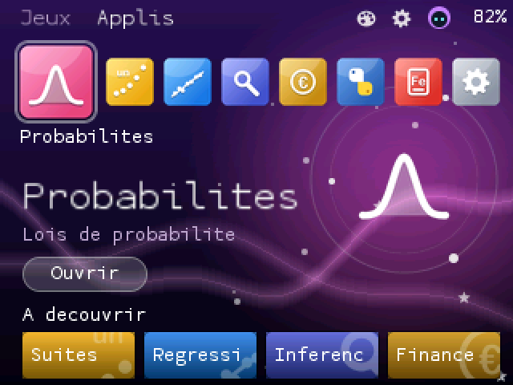 | 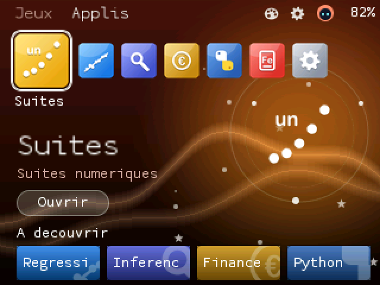 | 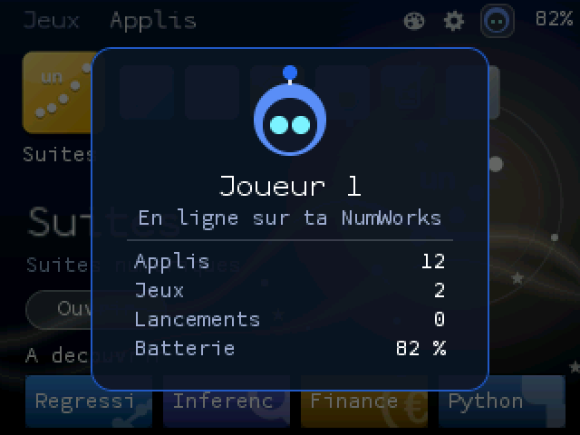 |

<p align="center">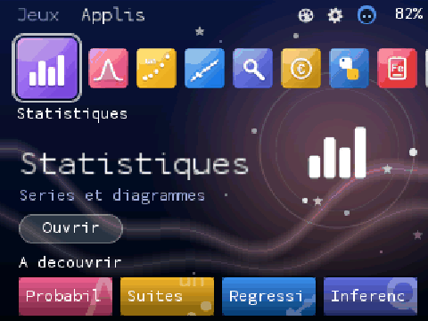</p>

## Commandes

| Touche | Accueil |
| --- | --- |
| Gauche / Droite | appli précédente / suivante |
| Haut | barre du haut (onglets, thèmes, paramètres, profil) |
| Bas | bouton Ouvrir, puis la rangée À découvrir |
| OK ou EXE | ouvrir l'appli (ou l'élément choisi) |
| Outils | changer d'onglet (Jeux / Applis) |
| Var | thème suivant |
| 1 à 9 | choisir la tuile n (deux fois : l'ouvrir), 0 : Paramètres |
| Retour ou Home | revenir à la rangée, puis à la première tuile |

N'importe quelle touche passe l'animation de démarrage ; OK passe l'écran
« Qui joue ? ».

## Installation

### 1. Obtenir PS5-OS

Depuis juillet 2021, le code d'Epsilon (le logiciel de la NumWorks) n'est plus
sous licence libre. PS5-OS ne publie donc **aucun code ni aucun firmware de
NumWorks** : seulement un **patch** (`patches/ps5-os-epsilon.patch`) et son
propre code. Le firmware se compile à partir des sources officielles de
NumWorks, dans ton compte GitHub ou sur ton Mac.

**Sans rien compiler (Mac ou Windows)**

1. En haut de cette page : **Use this template** > **Create a new
   repository**, coche **Private** (obligatoire : la compilation refuse de
   tourner dans un dépôt public, pour que le firmware ne soit pas
   téléchargeable par tous).
2. Facultatif : ajoute tes jeux `.nwa` dans le dossier `games/` de ta copie
   privée (*Add file* > *Upload files*).
3. Dans ta copie : onglet **Actions** > **Build PS5-OS** > **Run workflow**.
4. Environ 30 minutes plus tard (un firmware par modèle), en bas de la page
   de la compilation, télécharge **PS5-OS-Mac** ou **PS5-OS-Windows** et
   décompresse-le (deux fois pour la version Mac : GitHub met le zip dans un
   zip).

**En compilant sur ton Mac**

```bash
brew install make dfu-util libusb
brew install --cask gcc-arm-embedded
git clone https://github.com/derim00/ps5-os.git && cd ps5-os
./scripts/build-firmware.sh
```

Le script télécharge Epsilon au commit indiqué dans `EPSILON_COMMIT`,
applique le patch, compile, prépare les jeux de `games/` et remplit le
dossier `installer/`.

### 2. Installer sur la calculatrice

**Sur Mac**

1. Une seule fois : `brew install libusb dfu-util` (et
   `brew install --cask gcc-arm-embedded` pour ajouter d'autres jeux).
2. Double-clique sur **`Installer PS5-OS.command`** (la première fois :
   clic droit > **Ouvrir**). La page de l'installateur s'ouvre
   (http://127.0.0.1:8777).

**Sur Windows** (rien à installer : ni Python, ni pilote)

1. Décompresse **PS5-OS-Windows** (clic droit > *Extraire tout*).
2. Double-clique sur **`Installer PS5-OS.exe`** (si SmartScreen s'affiche :
   *Informations complémentaires* > *Exécuter quand même*). Laisse la
   fenêtre noire ouverte, ferme-la à la fin pour quitter.

**Ensuite, sur les deux**

3. Branche la calculatrice en USB et appuie sur **Reset** au dos : elle
   redémarre sur le système officiel.
4. Quand le voyant passe au vert, glisse tes jeux `.nwa` dans la page si tu
   veux, puis clique sur **Installer PS5-OS**.

Seul le **slot B** est écrit : le système officiel (slot A) n'est jamais
modifié.

## À savoir

- **Calculatrice** : NumWorks **n0110**, **n0115** ou **n0120**, logiciel
  officiel **26.4.0** dans le slot A. L'installateur choisit tout seul le
  firmware du modèle branché.
- **Un seul système dans le slot B** : PS5-OS remplace Mimi-OS, iOS-OS,
  Wii U-OS, Windows-OS, Switch-OS, PSP-OS… (et inversement). Les
  installateurs peuvent tourner en même temps (PS5-OS utilise le port 8777).
- **Après un Reset**, la calculatrice revient sur le système officiel : il
  suffit de relancer l'installation.
- **Thème et onglet** : ils restent choisis tant que la calculatrice ne
  redémarre pas (après un Reset, on revient au thème Cosmos et à l'écran « Qui joue ? »).
- **Accents** : la police de la NumWorks n'a pas de lettres accentuées ; les
  noms s'affichent sans accents.
- **Home et On/Off** : le correctif du plantage Home / On-Off de Windows-OS
  est repris. Home ramène toujours à l'écran d'accueil.
- **Jeux** : seulement des applis `.nwa` dont tu as le droit de te servir, et
  uniquement dans ta copie privée : jamais dans un dépôt public.

## Comment c'est fait

| Fichier (dans le patch) | Rôle |
| --- | --- |
| `apps/home/ds/shell.cpp` | écran d'accueil : démarrage, « Qui joue ? », onglets, rangée de tuiles, image d'en-tête, À découvrir, profil, thèmes et toutes les animations |
| `apps/home/ds/gfx.cpp` | rendu par bandes en RAM (repris d'iOS-OS et Mimi-OS), images avec transparence, texte, formes arrondies, traits antialiasés |
| `apps/home/ds/gen_icons.py` | dessine les tuiles des applis, leurs grands symboles et les icônes de la barre du haut dans `ds_icons.h` |
| `apps/home/controller.cpp` | relie l'accueil à Escher et dessine les animations directement à l'écran |
| `escher/include/escher/palette.h`, `theme/light_theme.h` | le thème bleu de toute la calculatrice |
| `escher/src/run_loop.cpp` | animations : l'appli d'accueil peut demander une image toutes les 40 ms |
| `scripts/photos.py` | transforme la séance photo du simulateur (`DS_SHOTS=dossier`) en PNG et GIF |

## Licence

Le code de PS5-OS est sous licence **CC BY-NC-SA 4.0** (voir `LICENSE`).
Epsilon reste la propriété de NumWorks et n'est pas inclus dans ce dépôt.
Les icônes, le robot et les images sont des dessins originaux : aucune image,
aucun logo, aucun symbole de manette, aucun jeu ni personnage de Sony n'est
utilisé. PS5-OS est un projet de fan, sans lien avec NumWorks ni Sony
Interactive Entertainment. PlayStation et PS5 sont des marques de Sony
Interactive Entertainment.
